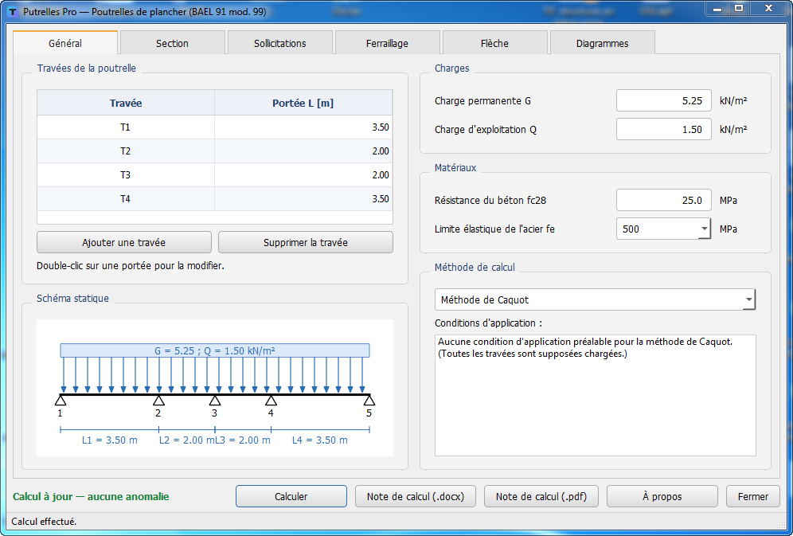
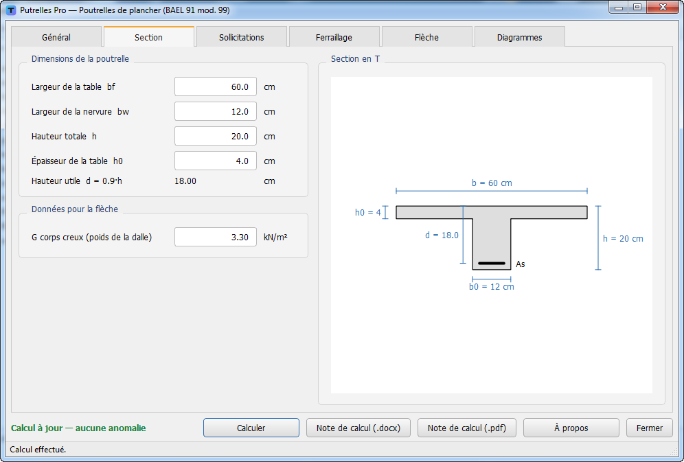
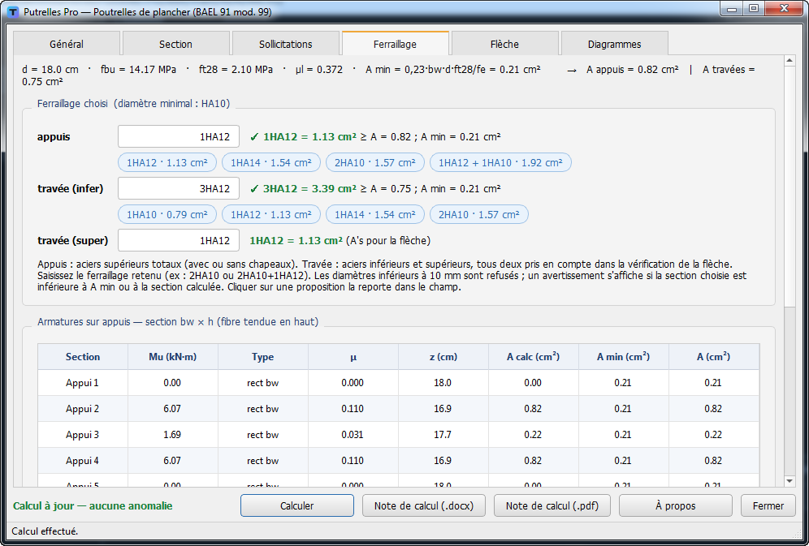
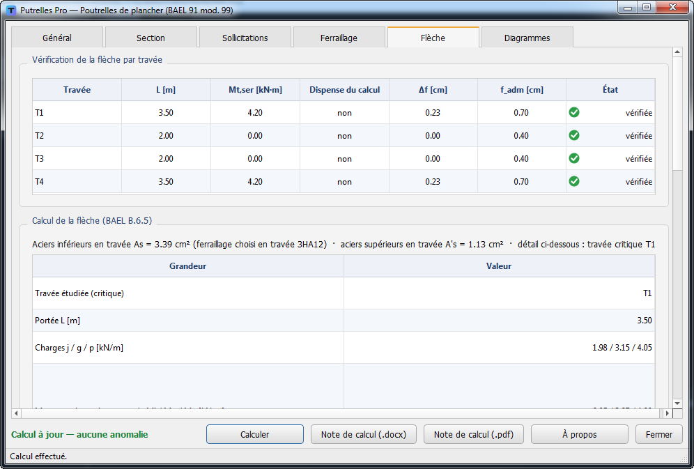

# 🏗️ Putrelles Pro

**Putrelles Pro – BAEL 91 mod. 99**

Application de calcul et de dimensionnement des poutrelles continues de planchers à corps creux selon le règlement BAEL 91 modifié 99.

**Version actuelle : 1.1.0**

## 📥 Téléchargement

[**Télécharger Putrelles Pro v1.1.0 (Windows)**](https://github.com/hammoumorsli/Putrelles-Pro/releases/latest/download/PutrellesPro_1.1.exe)

[Voir toutes les versions](https://github.com/hammoumorsli/Putrelles-Pro/releases)

## ✨ Fonctionnalités principales

- Gestion des travées (ajout, suppression et modification).
- Définition des charges permanentes (G) et d'exploitation (Q) indépendamment pour chaque travée.
- Application automatique des charges générales à toutes les travées, avec possibilité de modification individuelle.
- Représentation graphique du schéma statique et des charges.
- Calcul des sollicitations aux ELU et ELS.
- Méthode forfaitaire.
- Méthode de Caquot.
- Méthode de Caquot minorée.
- Avertissement lorsque les conditions d'application d'une méthode ne sont pas satisfaites.
- Calcul des sections rectangulaires et en T.
- Dimensionnement et choix des armatures longitudinales.
- Vérification des armatures minimales et du cisaillement.
- Vérification de la flèche travée par travée, à partir des armatures choisies.
- Diagrammes des moments fléchissants et des efforts tranchants.
- Génération automatique des notes de calcul aux formats Word (.docx) et PDF.

## 🆕 Nouveautés de la version 1.1.0

- Gestion indépendante des charges G et Q pour chaque travée.
- Les charges générales sont automatiquement affectées à toutes les travées.
- Possibilité de modifier les charges des travées particulières (balcons, couloirs, cloisons, etc.).
- Compatibilité avec les anciens projets.

## 🧪 Vérification des résultats

- Comparaison des moments en travée et sur appuis (méthode de Caquot) avec une feuille Excel de référence, y compris pour des charges différentes d'une travée à l'autre.
- Comparaison du calcul de la flèche avec l'application EXPERT BA.
- D'autres vérifications et comparaisons sont en cours.

## 🛠️ Technologies

Python 3.8 · PyQt5 · Matplotlib · python-docx · Windows

**Développé par : Morsli Hammou**

## 🖥️ Captures d'écran

### Interface principale

### Schéma statique et gestion des travées

### Calcul des sollicitations

### Ferraillage

### Vérification de la flèche

### Diagrammes

## ⚠️ Avertissement

Les résultats fournis par cette application doivent être vérifiés par un ingénieur qualifié avant toute utilisation dans un projet réel.
