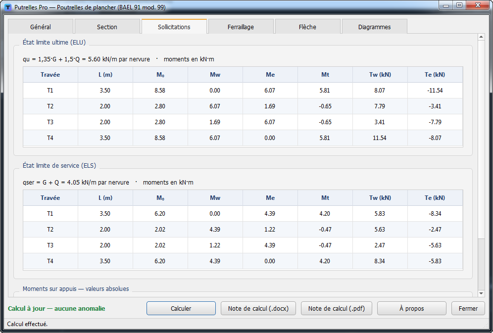
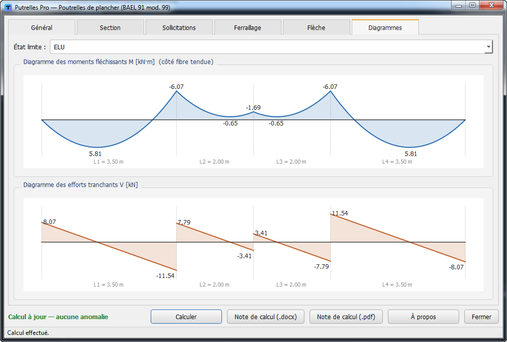

# Putrelles Pro

Putrelles Pro – BAEL 91 mod. 99

Application de calcul et de dimensionnement des poutrelles continues de plancher à corps creux selon le règlement BAEL 91 modifié 99.

## Fonctionnalités principales

- Gestion des travées (ajout, suppression et modification).
- Représentation graphique du schéma statique et des charges.
- Calcul des sollicitations aux ELU et ELS.
- Méthode forfaitaire.
- Méthode de Caquot.
- Calcul des sections rectangulaires et en T.
- Dimensionnement et choix des armatures longitudinales.
- Vérification de la flèche.
- Diagrammes des moments fléchissants et des efforts tranchants.
- Génération automatique des notes de calcul Word et PDF.

## Technologies

Python 3.8 · PyQt5 · Matplotlib · python-docx · Windows

Développé par : Morsli Hammou

## 🖥️ Captures d'écran

### Interface principale

### Schéma statique et gestion des travées

### Calcul des sollicitations

### Ferraillage

### Vérification de la flèche

### Diagrammes

